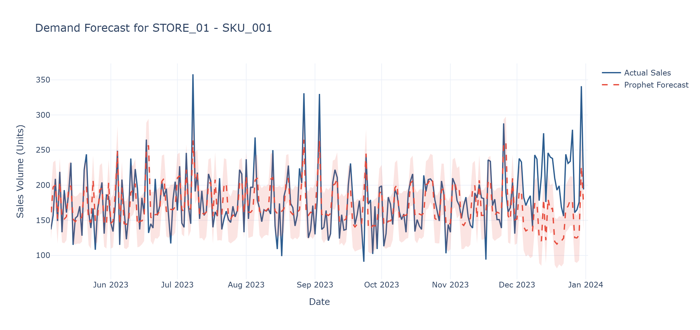

# Demand Forecasting System 📦📈

Ever wondered how much stock a store actually needs next month? Order too much and you're paying for warehouse space full of stuff nobody buys. Order too little and you've got empty shelves and unhappy customers.

That's the problem this project tackles. It's a demand forecasting pipeline that combines solid data engineering with two forecasting approaches: a **Prophet** baseline that's quick to train and easy to explain, and a **Temporal Fusion Transformer (TFT)** scaffold for when you need to forecast many store–SKU series at once.

## What's under the hood

The whole flow runs end-to-end from a single command. Here's the journey your data takes:

1. **Synthetic data generation** — Two stores, three SKUs, a full year of daily sales. Sales come with realistic behavior baked in: weekly and yearly seasonality, holiday spikes, promo uplift, and a bit of noise. It also deliberately punches holes in the data (missing days) so we can show off the imputation step.
2. **DuckDB-powered cleaning** — Instead of furiously copying pandas DataFrames around, the raw data lands in a local [DuckDB](https://duckdb.org/) database where a SQL pipeline fills the missing dates and produces a clean `cleaned_sales` table. Fast, zero-setup, and honestly kind of fun.
3. **Prophet baseline** — Trains on a single store–SKU series with `is_promo` and `on_holiday` as extra regressors, so the model knows *why* demand spiked, not just that it did.
4. **TFT feature prep** — Builds the time-varying features (lags, rolling stats, calendar fields) that PyTorch Forecasting's Temporal Fusion Transformer needs. The multi-series setup means one model can learn across all store–SKU combinations.
5. **Evaluation that means something** — We score forecasts with **WAPE** and **SMAPE** — the metrics retail teams actually look at, since they talk in percentages rather than "&lt;squint&gt;... squared errors?"
6. **Interactive charts** — A Plotly dashboard compares actuals against the forecast, complete with a shaded uncertainty band. Hover to inspect any day.

## Results

A sample run on `STORE_01 | SKU_001` looks like:

```
--- 1. Generating Synthetic Store Data ---
--- 2. Setting up DuckDB Imputation Pipeline ---
--- 3. Running Prophet Benchmark ---

Model Evaluation Metrics (STORE_01 | SKU_001):
 -> WAPE : ...
 -> SMAPE: ...

--- 4. Preparing TFT Multi-Series Features ---
--- 5. Plotting Interactive Results ---
```

And here's what the forecast output looks like (actual sales in blue, Prophet's prediction dashed in red, uncertainty band shaded):



*(Run the pipeline yourself to regenerate this chart with live numbers for your data.)*

## Project structure

```
demand_forecasting_system/
├── main.py                      # Runs the full pipeline end to end
├── requirements.txt
└── src/
    ├── data_loader.py           # Synthetic data + DuckDB storage & imputation
    ├── preprocessing.py         # TFT feature engineering
    ├── evaluation.py            # WAPE / SMAPE metrics
    ├── viz.py                   # Plotly forecast dashboard
    └── models/
        ├── prophet_baseline.py  # Prophet with promo/holiday regressors
        └── tft_pipeline.py      # Temporal Fusion Transformer inputs
```

## Getting started

You'll need Python 3.9+.

```bash
# 1. Get the code
git clone https://github.com/Pratham1-hue/demand_forecasting_system.git
cd demand_forecasting_system

# 2. Install dependencies
pip install -r requirements.txt

# 3. Run it
python main.py
```

That's it. You'll see the pipeline stages print to the console, the evaluation metrics, and a Plotly dashboard will pop up in your browser.

> ⚠️ **Prophet note:** on Windows, installing Prophet sometimes needs Visual C++ Build Tools. If `pip install prophet` complains, grab the tools or install from a pre-built wheel.

## Ideas for taking it further

- [ ] Swap the synthetic data for a real retail dataset (M5, Kaggle store sales, etc.)
- [ ] Actually train the TFT — the input prep is there, hook in a trainer
- [ ] Backtest across *all* store–SKU combos, not just one
- [ ] Wrap it in Streamlit so non-technical folks can play with it
- [ ] Add hyperparameter tuning for the Prophet baseline

## Tech stack

Python · Pandas · DuckDB · Prophet · PyTorch Forecasting · Plotly

---

Built with ☕ and a healthy respect for empty shelves.
